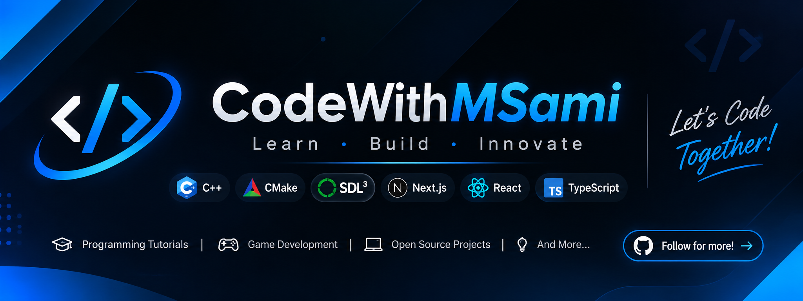

# 👋 Hi, I'm Sami (CodeWithMSami)

  
  

  <h3>Learn · Build · Innovate</h3>

  
Developer · Programmer · AI Enthusiast

  

    Exploring software engineering, computer science, web development,
    game development, and artificial intelligence.
  

  
  
  
  

---

## 👨‍💻 About Me

I'm Sami, a developer interested in building software and understanding the technology behind it.

I enjoy exploring different areas of computer science, experimenting with tools, and improving my programming skills.

- 💻 Interested in software engineering and programming.
- ⚙️ Exploring systems programming and modern C++.
- 🌐 Interested in full-stack and modern web development.
- 🎮 Exploring game development and computer graphics.
- 🤖 Interested in artificial intelligence and LLM engineering.
- 🎨 Also interested in animation, video editing, and 3D graphics.

---

## 🛠️ Technologies & Tools

An evolving collection of technologies, frameworks, and tools I use and explore.

### Programming Languages

  

### Web Fundamentals & Markup

  

### Frontend Development

  

### Backend Development & APIs

  

### Databases & Backend Platforms

  

### Artificial Intelligence & Data Science

  

### Mobile & Game Development

  

### Desktop & GUI Development

  

### UI/UX, Animation & Creative Software

  

### Build Systems, Bundlers & Package Managers

  

### Development Environments & Editors

  

### Version Control

  

### Operating Systems

  

### Shells & Command-Line Environments

  

### Cloud & Deployment Platforms

  

### CMS & Website Builders

  

### Communication & Community

  

### Automation & Bots

  

### Other Tools

  

---

## 🧭 Areas of Interest

| Area | Interests |
|---|---|
| Software Engineering | Programming, problem solving, software architecture |
| Systems Programming | C++, low-level development, computer science |
| Game Development | Game engines, graphics programming, rendering |
| Web Development | Frontend, backend, full-stack applications |
| Artificial Intelligence | Machine learning, deep learning, LLM engineering |
| Creative Development | Animation, video editing, 3D graphics |

---

## 📚 Learning & Exploration

I believe in understanding fundamentals, learning continuously, and improving through practical experimentation.

My interests and learning direction evolve as I explore new technologies and concepts.

---

  

## 🏆 GitHub Achievements

  

## 📊 GitHub Profile Statistics

  
  

  

## 🤝 Connect With Me

  
  
  
  

---

  <h3>Thanks for visiting!</h3>

  
<strong>Learn · Build · Innovate</strong>

